# USDC Checkout Prototype — cross-border stablecoin payments for a Singapore merchant

**A buyer in the US pays a Singapore store 120 USD in USDC on Base Sepolia. The payment is matched to the order automatically, pushed to the merchant by webhook, settled to SGD daily, and reconciled three ways. Refunds and every exception path are built in.**

> ⚠️ **This prototype connects to testnets only and does not process real funds.** The merchant ("Atelier Kelong") and the payment service provider are fictional. FX conversion and bank credits are simulated and labelled as such in the UI.

Part of a product-management portfolio. The product requirements are in [`docs/PRD.md`](docs/PRD.md) (Chinese), with requirement IDs traced in the [table below](#requirement-traceability). The interface switches between English and 中文 from the control in the bottom-right corner. New here? Open the homepage and follow the [main flow](#main-flow).

---

## Verified on Base Sepolia

End-to-end run on 2026-10-24 (order `ORD-30018`, 120 USD → 1.20 test USDC at 1/100 testnet scale):

- **Payment** buyer → per-order deposit address, auto-matched to the order: [`0xf56a0715…eb46559a`](https://sepolia.basescan.org/tx/0xf56a0715811dc7d7c74eed23e48dd15e62801f5cd276910322c5ae5aeb46559a)
- **Refund** in full to the original address via EIP-3009, gas paid by the platform: [`0x42431e65…10667b40`](https://sepolia.basescan.org/tx/0x42431e654ac69d1795951f61a118ba47a5077520e01dfe8cfe4b661910667b40)

- **Gasless payment** (`ORD-52794`): a brand-new wallet holding 1.20 test USDC and exactly **0 ETH** signed an EIP-3009 authorisation; the platform submitted it and paid the gas. The order matched and succeeded normally, and the wallet still held 0 ETH afterwards. [tx](https://sepolia.basescan.org/tx/0x2282b0b0162e692d716292d114884f9b0928f0ea098fc2d63791d924a8546667)

Exception paths, also on the real testnet:

- **Underpay → top-up** (`ORD-94067`): paid 0.90 → status *underpaid, 0.30 due* → topped up 0.30 → *succeeded* with both transfers summed. [0.90](https://sepolia.basescan.org/tx/0x289b006e31152c5a43df37d8fa0e4ba9fd199b750cf6c1032e16c5bcbbe14b02) · [0.30](https://sepolia.basescan.org/tx/0x44214d94a5fcf42dad0fb3bc19e71caa8dd4033909abac4bfa4b059ec3847ee5)
- **Overpay** (`ORD-33711`): paid 1.32 for a 1.20 order → order *succeeded* and the 0.12 excess was refunded automatically. [payment](https://sepolia.basescan.org/tx/0x7b9e5438e9f4bcfb195d88c8ed0fe993d6552c89262672955c7152b21a550662) · [excess refund](https://sepolia.basescan.org/tx/0xe3c75de0d548759ed80316e6262461b32decc376dc41383a31db82d67a13f350)

## Screenshots

| Buyer checkout | Payment page: sign once, platform pays gas | Paid (underpay → top-up, real testnet) |
| --- | --- | --- |
| 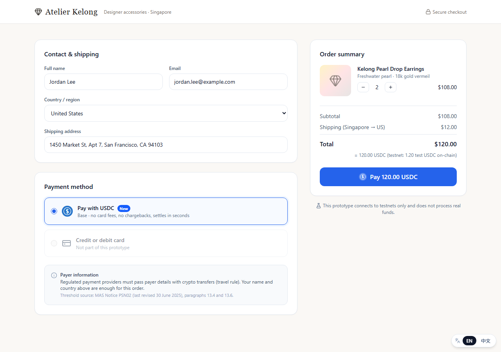 | 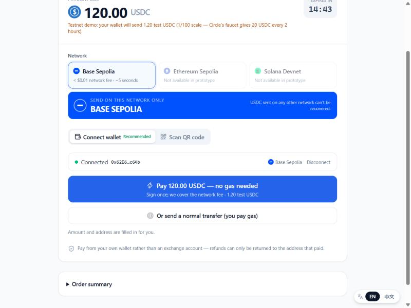 | 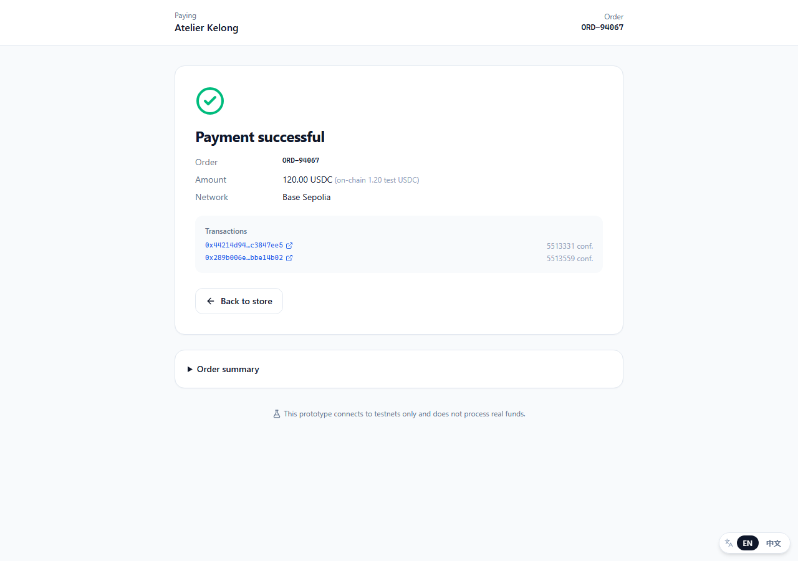 |

| Merchant overview | Order detail: two real transfers matched to one order | Webhooks with retries |
| --- | --- | --- |
| 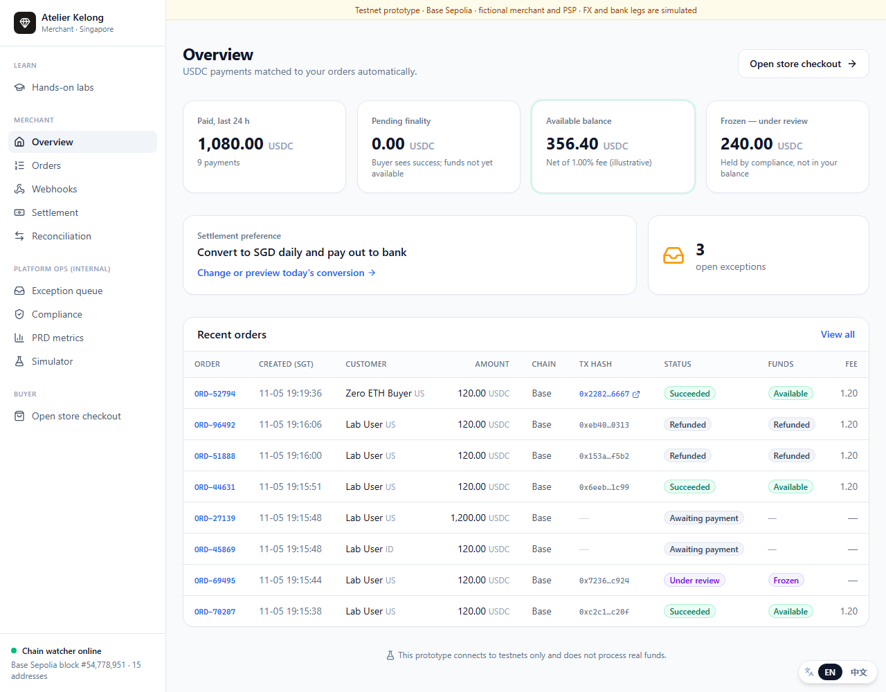 | 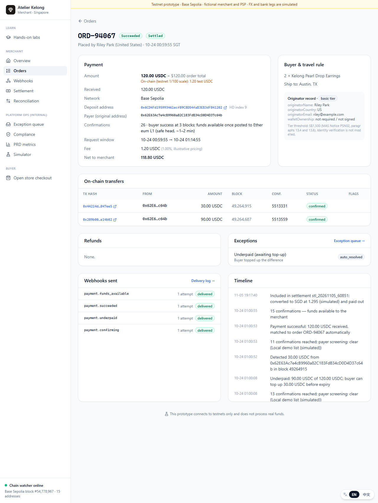 | 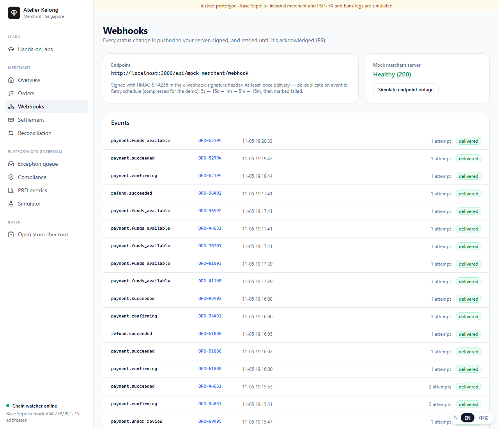 |

| Exception queue | Three-way reconciliation (breaks in red) | Mobile |
| --- | --- | --- |
| 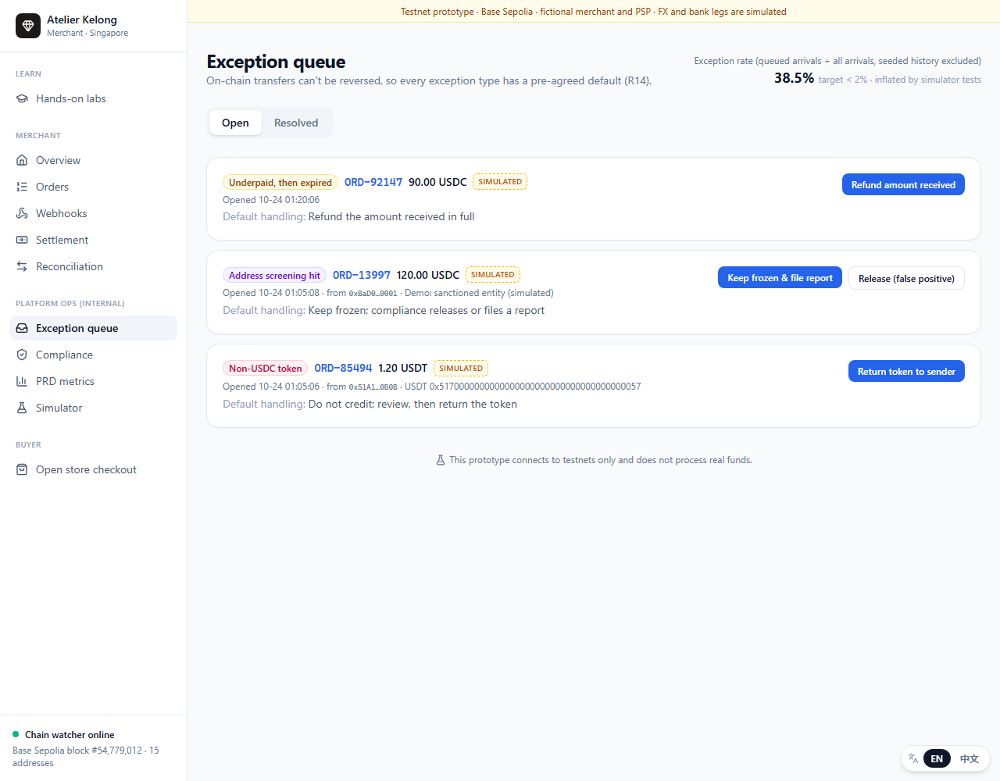 | 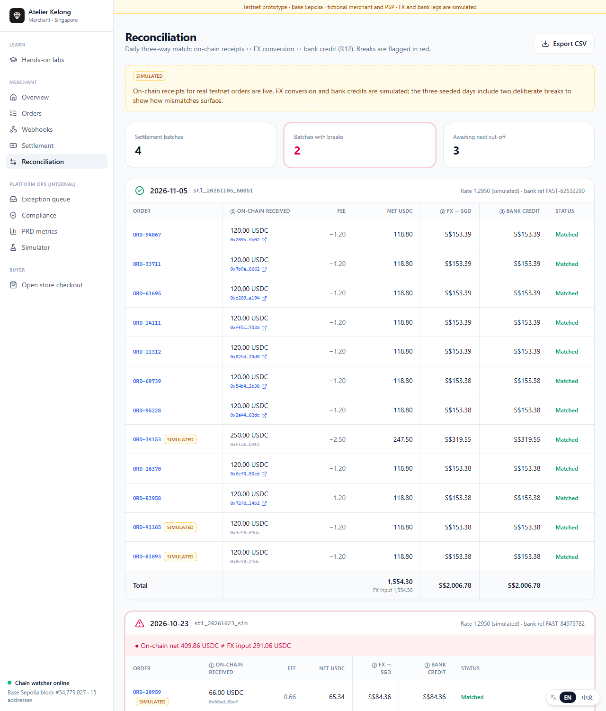 | 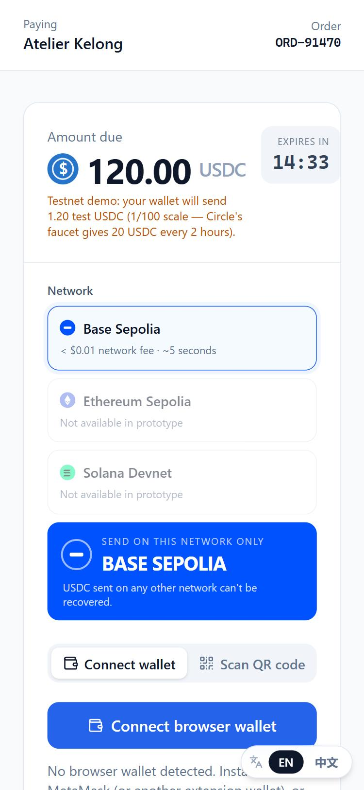 |

| PRD metrics + checkout funnel | Main flow on the homepage |
| --- | --- |
| 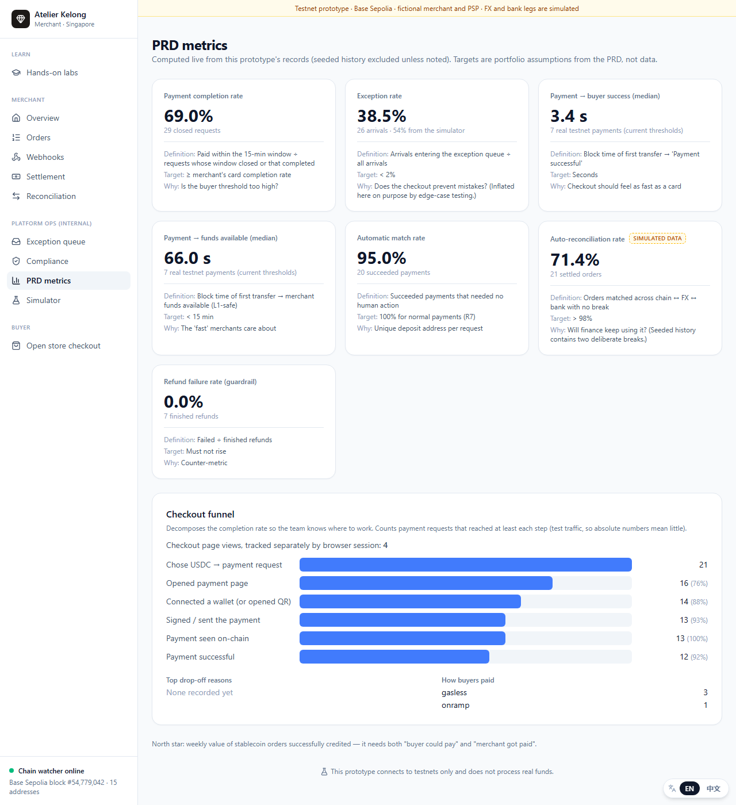 | 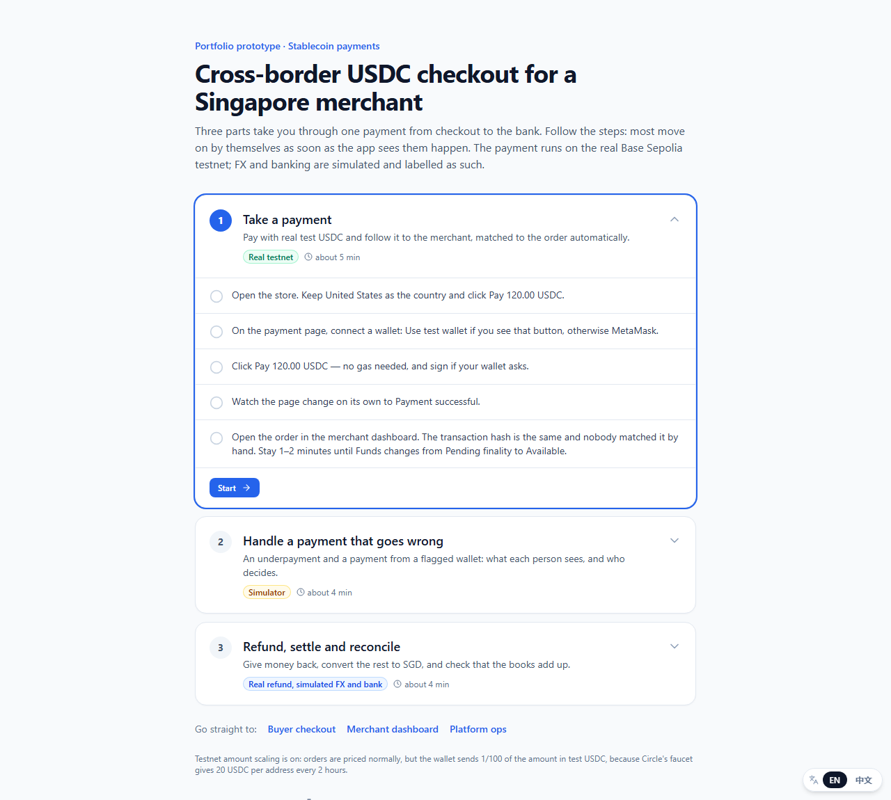 |

## Main flow

The homepage takes you through the product in three parts. A card follows you from page to page with the current step, and most steps move on by themselves once the app's records show them happening. Everything is in both English and Chinese.

| Part | What you do | What it shows |
| --- | --- | --- |
| 1. Take a payment | Check out, pay with test USDC, open the order | The whole chain to the merchant, and why buyer and merchant get different answers at different times |
| 2. Handle a payment that goes wrong | Underpay and top up; pay from a flagged wallet | Rules for irreversible mistakes, and what each role gets to see |
| 3. Refund, settle and reconcile | Refund, run the SGD settlement, read reconciliation | Why refunds only go to the original address, and what the merchant needs after the USDC arrives |

Part 1 pays and part 3 refunds about 1.20 test USDC on the real testnet. Part 2 and the FX and bank legs use the simulator.

## What's real and what's simulated

| Leg | Status |
| --- | --- |
| Checkout, payment request, unique deposit address per order | **Real** (HD-derived addresses) |
| Buyer pays USDC from a browser wallet or an EIP-681 QR code | **Real** Base Sepolia transfer |
| Chain watcher: detection, confirmations, reorg check, matching | **Real** (polls `eth_getLogs` on Base Sepolia) |
| Refunds to the original address | **Real** testnet transfer (EIP-3009, gas paid by the platform) |
| Webhooks with HMAC signatures and retries | **Real** HTTP, sent to a bundled mock merchant server |
| Address screening, region gating, travel-rule tiers | Wired into the flow, but uses **local demo lists** |
| USDC → SGD conversion and bank payout | **Simulated** |
| Order history on the reconciliation page | **Simulated** seed data |
| Payment simulator (under/over/late/non-USDC/screening hit) | **Simulated** transfers fed through the real pipeline |

## Architecture

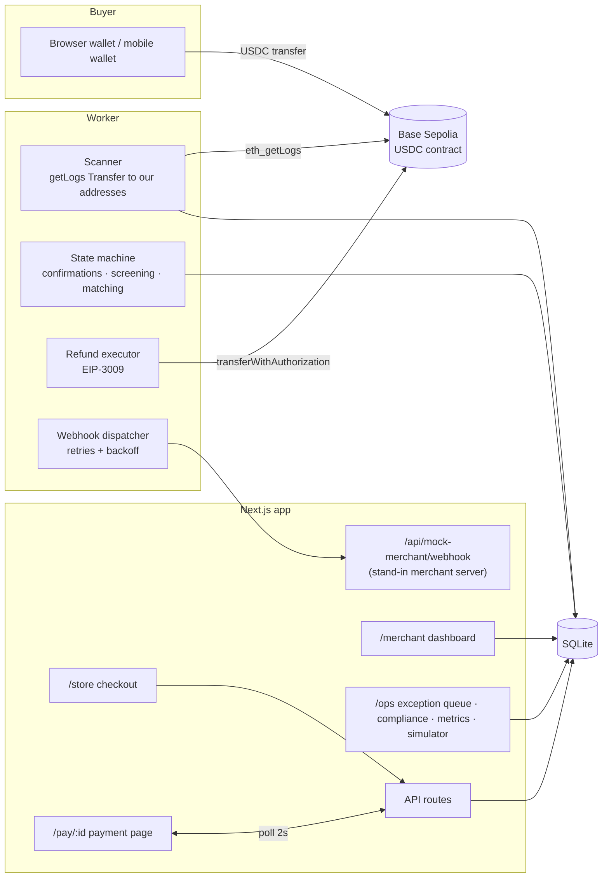

The Next.js server and the worker are two processes sharing one SQLite file (WAL mode). `npm run dev` starts both.

### Payment state machine

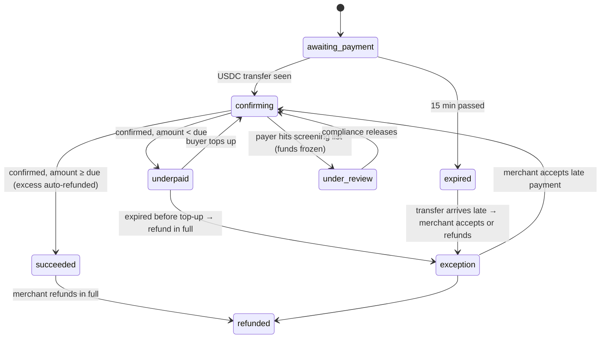

Funds have their own status, separate from the buyer-facing one (PRD decision 2): `pending_finality → available → settled`, or `frozen` / `refunded`.

## Run it locally (Windows / PowerShell, macOS, Linux)

Requirements: **Node.js ≥ 20.9** and npm. No other system software is needed.

```bash
npm install
```

```bash
npm run setup
```

`setup` writes a `.env` with freshly generated **testnet-only** secrets (HD seed, a throwaway test-buyer key, webhook secret), creates the SQLite database and seeds demo data. It prints two addresses:

- **Gas sponsor** (HD index 0) pays gas for refunds and needs a little Base Sepolia ETH.
- **Test buyer** is optional. It's used by `npm run pay:test` to make a real payment without a browser wallet.

```bash
npm run dev
```

Then open http://localhost:3000.

Other scripts:

| Script | What it does |
| --- | --- |
| `npm run wallets` | Balances of the gas sponsor and test buyer |
| `npm run fund:sponsor -- 0.003` | Send ETH from the test buyer to the gas sponsor |
| `npm run pay:test -- <paymentRequestId> [amount]` | Pay a request from the test buyer (real testnet tx) |
| `npm run db:reset` | Wipe and re-seed the database (stop `dev` first) |
| `npm run typecheck` | TypeScript check |
| `npm test` | Offline state-machine tests (no RPC or funds needed) |

### Dev-only test wallet (no MetaMask needed)

Set `NEXT_PUBLIC_DEV_TEST_WALLET=1` in `.env` and restart `npm run dev`. The payment page then shows a dashed **"Use test wallet (dev only)"** button. It's an EIP-1193 provider plugged into wagmi's `injected` connector, so the page runs exactly the code path MetaMask would: connect → switch chain → `transfer()` → wait, plus the ownership signature for large orders. Signing happens server-side with `TEST_BUYER_PRIVATE_KEY`. The route refuses anything except USDC `transfer()` calls, USDC transfer authorisations and ownership messages, and it's disabled in production builds. The real-wallet path is identical apart from the provider.

### Getting testnet funds

- **USDC:** [Circle faucet](https://faucet.circle.com). Choose USDC and Base Sepolia. It gives 20 USDC per address every 2 hours.
- **ETH for gas:** any Base Sepolia faucet listed in the [Base docs](https://docs.base.org/base-chain/tools/network-faucets), e.g. the Coinbase Developer Platform faucet.

USDC on Base Sepolia: `0x036CbD53842c5426634e7929541eC2318f3dCF7e`, verified against [Circle's contract address list](https://developers.circle.com/stablecoins/usdc-contract-addresses).

**Testnet amount scaling.** Because the faucet only gives 20 USDC at a time, by default the wallet sends 1/100 of the order amount: a 120 USD order asks for **1.20 test USDC**. Everything else (ledger, fees, settlement, reconciliation) uses the real order value. The UI says this wherever an on-chain amount appears. Set `NEXT_PUBLIC_TESTNET_AMOUNT_DIVISOR=1` in `.env` to pay 1:1.

## Testnet demo walkthrough

1. **Checkout:** open `/store`. Two earrings at $54 plus $12 shipping comes to $120. Leave the country as United States and click **Pay 120.00 USDC**.
   - Switch the country to Indonesia and the USDC option disappears (R16).
   - Raise the quantity above about $1,158 and the enhanced travel-rule fields appear.
2. **Pay:** on `/pay/:id`, note the 15-minute timer, the chain picker (only Base Sepolia is selectable) and the large network banner. **Connect wallet**: MetaMask switches to Base Sepolia automatically. Click **Pay** and confirm. Alternatively, scan the QR code with a mobile wallet.
3. **Confirming → success:** within a few seconds the page shows "Payment detected — confirming". After 10 blocks (about 2 seconds on Base Sepolia) it shows **Payment successful**, with the order number and a Basescan link.
4. **Merchant:** `/merchant/orders/:id` shows the matched transfer, confirmations, fee, the travel-rule record and the timeline. The funds become **Available** once the block is posted to Ethereum L1 (the chain's `safe` head). The measured median was about 1.5 min (92 s over 5 real payments); see `/ops/metrics`.
5. **Webhooks:** `/merchant/webhooks` lists the `payment.confirming → succeeded → funds_available` events. Click **Simulate endpoint outage**, place another order and watch the retries.
6. **Refund:** on the order page, click **Refund in full**. The destination is re-screened, then the deposit address signs an EIP-3009 authorisation and the gas sponsor submits it. A real refund transaction appears on Basescan.
7. **Settlement and reconciliation:** on `/merchant/settlement`, click **Run today's settlement** (simulated). Then on `/merchant/reconciliation`, see your order matched across all three columns. The seeded days show the two deliberate breaks in red. Export the CSV.
8. **Edge cases:** use `/ops/simulator` to underpay, overpay, send USDT, pay from a screened address or pay late. Then handle each case in `/ops/exceptions`.
9. **Gasless:** on the payment page, **"Pay … — no gas needed"** asks the wallet for one signature, and the platform submits and pays gas.
10. **Metrics:** `/ops/metrics` computes the PRD's metrics live from the prototype's own records: completion rate, exception rate, median time to buyer success and to merchant funds available, auto-match rate and auto-reconciliation rate, plus the checkout funnel.

## Requirement traceability

| PRD | Requirement | Where |
| --- | --- | --- |
| R1 | Payment request per order (amount, address, chain, expiry); one active request per order | `src/lib/payments.ts` `createPaymentRequest` |
| R2 | Chain picker shows supported chains with fee/time estimates; unsupported ones can't be selected | `src/config/chains.ts`, `PayClient.tsx` `ChainPicker` |
| R3 | Connect wallet (auto chain switch) or EIP-681 QR; no manual amount or address entry | `PayClient.tsx` `WalletPay`, `QrPay` |
| R4 | 15-minute countdown; late arrivals go to the exception queue | `src/config/app.ts`, `src/lib/engine.ts` `expire`, `ingestTransfer` |
| R5 | Per-chain confirmation thresholds; "confirming" until reached | `src/config/chains.ts`, `engine.ts` `evaluateOne` |
| R6 | Live status for buyer and merchant (≤ 5 s) | Buyer polls every 2 s; dashboard refreshes every 3 s; worker ticks every 3 s |
| R7 | Unique deposit address per request, matched automatically | `src/lib/hd.ts`, `engine.ts` `scan` |
| R8 | Merchant order view: id, amount, chain, tx hash, status, fee, explorer links | `/merchant/orders`, `/merchant/orders/[id]` |
| R9 | Webhooks with automatic retries and a delivery log | `src/lib/webhooks.ts`, `/merchant/webhooks` |
| R10 | Settlement preference; rate and fee shown before conversion; traceable to orders | `src/lib/settlement.ts`, `/merchant/settlement` (simulated FX) |
| R11 | Withdraw held USDC to whitelisted wallets; second verification for new addresses | `/merchant/settlement` (hold-USDC mode, simulated) |
| R12 | Daily three-way reconciliation with mismatches flagged; CSV export | `src/lib/reconciliation.ts`, `/merchant/reconciliation` |
| R13 | Full refund to the original address, re-screened first; buyer notified | `src/lib/refunds.ts`; buyer email is simulated |
| R14 | Exception queue: under/over/late/non-USDC, each with a default action | `src/lib/engine.ts`, `src/lib/exceptions.ts`, `/ops/exceptions` |
| R15 | Screening before funds reach the merchant; hits frozen | `src/lib/compliance.ts` `screenAddress`, `engine.ts` (`under_review`) |
| R16 | Restricted regions don't see USDC; list editable by compliance | `/ops/compliance`, `CheckoutForm.tsx`, server check in `createCheckout` |
| R17 | Partial refunds, multi-language checkout | Out of scope (v2), as in the PRD |
| R18 | **Gasless checkout**: buyer signs, platform pays gas (EIP-3009) | `api/payments/[id]/gasless`, `PayClient.tsx` `payGasless` |
| R19 | **Checkout funnel** and drop-off reasons | `src/lib/funnel.ts`, `/ops/metrics` |

R18–R19 were added after the prototype exposed gaps in the PRD. Rationale and acceptance criteria are in [`docs/PRD-additions.md`](docs/PRD-additions.md).

PRD decisions that show up in the code:

1. **Three chains, one live:** `CHAINS` in `src/config/chains.ts`.
2. **Split thresholds, calibrated on the real chain:** Base Sepolia produces a block every 0.2 s (measured over 10,000 blocks). The buyer sees success after 10 blocks, about 2 s (50 blocks, about 10 s, for orders ≥ $1,000). Merchant funds become available only when the block is at or below the OP Stack **`safe` head**, meaning it has been posted to Ethereum L1. That lag is about 1–2 min; `finalized` would be about 15–16 min, the option for very large amounts. Reorg checks run again before funds are released. A block count (300) is the fallback for RPCs without the `safe` tag. Exact production values are still an open PRD question for engineering.
3. **USD pricing, 15-minute quote:** `PAYMENT_REQUEST_TTL_MS`.
4. **Refunds only to the address that paid:** there is no way for a buyer or merchant to enter a different refund address. How to serve buyers who paid from an exchange is still an open PRD question.
5. **Default to daily SGD conversion:** the settings default is `auto_sgd`.

## Technical decisions (and deviations from the original plan)

- **Separate worker process** instead of running the scanner inside Next.js. A long-running loop doesn't fit the request lifecycle or dev hot-reload, and it mirrors how a payment processor would actually run it.
- **Scanning with `eth_getLogs`, without filtering by token contract.** The query matches the `Transfer` topic plus our addresses as `to`, so *any* ERC-20 sent to a deposit address is seen. That's how non-USDC arrivals are caught (R14). The public RPC limits queries to 200 blocks, so the scanner reads 150-block chunks.
- **Reorg check:** before a transfer counts as confirmed, the worker re-fetches the receipt and compares block hashes.
- **Gasless refunds via EIP-3009.** Circle's USDC implements `transferWithAuthorization`. The deposit address signs an EIP-712 authorisation, and the gas-sponsor wallet submits it and pays gas. Deposit addresses never need ETH, and nothing has to be swept before a refund. Returning a non-USDC token falls back to topping up gas first.
- **SQLite via libsql** (`@libsql/client` + Drizzle) instead of better-sqlite3. better-sqlite3 needs a C++ toolchain on Windows; libsql ships prebuilt binaries through npm.
- **Browser-extension wallets only** (wagmi `injected()`), which means no WalletConnect project ID. Mobile wallets use the EIP-681 QR code.
- **Self-hosted wallet verification:** for enhanced-tier orders the buyer signs a free EIP-191 message proving control of the paying wallet (PRD 合规与风控).

## Testing

`npm test` runs 34 offline tests against throwaway SQLite files. Transfers are injected through the same `ingestTransfer` entry point the scanner uses, and the chain head is set by hand, so no RPC or test funds are needed.

- `tests/engine.test.ts` covers the PRD rules: one active request per order (R1), unique addresses (R7), region gating (R16), travel-rule tiers, exact/under/over/late/non-USDC/screened payments, duplicate log de-duplication, the expiry race, and L1-safe finality.
- `tests/regressions.test.ts` pins the bugs found by an independent review pass. Examples: a late transfer taking over an in-progress payment, non-idempotent "refund in full", retrying non-failed refunds, money arriving on a refunded order, flagged extra payments, and settlement of funds that are mid-refund.
- `tests/features.test.ts` covers gasless checkout rules, the funnel and the main flow's automatic checks.
- `tests/i18n.test.ts` checks that every string sent through the translator has a Chinese entry, and that translations keep their placeholders.

Beyond the offline tests, the real-testnet runs listed under [Verified on Base Sepolia](#verified-on-base-sepolia) exercise the same paths end to end.

## Known limitations

- **Testnet only, no real funds.** There is no mainnet configuration, on purpose.
- Only Base Sepolia is live. Ethereum Sepolia and Solana Devnet are display-only.
- Screening uses a local demo list, not a sanctions or blockchain-analytics provider. Region gating uses the shipping country, not IP or KYC data.
- FX, bank payouts, whitelist 2FA and withdrawals are simulated. Platform fee (1.00%) and FX spread (0.30%) are illustrative numbers, not real pricing.
- The travel-rule tiers follow MAS Notice PSN02 (last revised 30 June 2025), paragraphs 13.4 and 13.6. The prototype collects the fields but doesn't perform the identity verification the notice requires above S$1,500. Converting the threshold to USD uses a simulated rate.
- No authentication on the dashboards or ops tools.
- Funds stay on the per-order deposit addresses; there's no treasury sweep. Watching stops 7 days after a request is created. After downtime the worker resumes at the chain tip, so new payments are seen right away, and rechecks the missed blocks in the background. Blocks older than the oldest watched request are not rechecked, since no deposit address existed yet.
- Refunds of orders already converted to SGD are blocked: they would need a debit on the next payout, which isn't modelled.
- Native ETH sent to a deposit address isn't detected (only ERC-20 `Transfer` events are).
- Third-party figures in the PRD (Stripe fees, etc.) are not shown as facts in the UI.

## Project layout

```
src/
  app/
    store/            buyer checkout
    pay/[id]/         payment page (wagmi)
    (admin)/merchant/ overview, orders, webhooks, settlement, reconciliation
    (admin)/ops/      exception queue, compliance, metrics, simulator
    api/              route handlers (+ mock merchant webhook receiver)
  config/             chains, thresholds, product, compliance defaults
  db/                 Drizzle schema, client, migrations runner
  i18n/               language switch and Chinese translations
  guide/              the homepage's three-part main flow: steps, automatic checks, step card
  lib/                engine (scanner + state machine), refunds, webhooks, compliance,
                      settlement, reconciliation, simulator, seed data
worker/index.ts       chain worker loop
scripts/              setup, reset, wallets, pay:test, fund:sponsor
tests/                offline state-machine + regression tests (node:test via tsx)
drizzle/              SQL migrations
docs/                 PRD (+ PRD-additions R18–R19), case study, screenshots
```

## Security notes

- `.env` holds the HD seed and test keys. It's git-ignored, and `.env.example` documents every variable. Use **testnet-only** keys.
- Webhooks are signed with HMAC-SHA256 (`x-webhook-signature: t=…,v1=…`), and the mock receiver verifies the signature.
