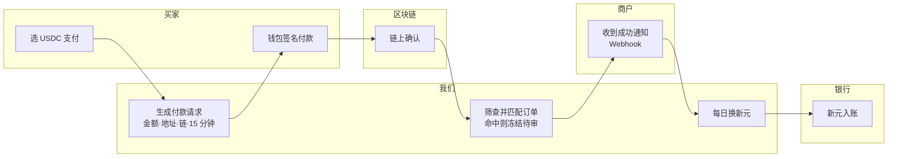

# PRD：稳定币跨境收款结账（作品 1）

2026-10-23 · Yixin

> 原文在 Claude 文档里：https://claude.ai/artifact/NFr6QYn4WzgDMqNQuA8jgw ，本文件是导出版。两者不一致时以 Yixin 最新的说明为准。

## 概要

给新加坡跨境电商做一个稳定币结账产品：海外买家用 USDC 付款，商户按自己的选择收到新元或 USDC。

- **用户**：新加坡中小跨境电商（付钱的客户），以及他们在海外的买家。
- **场景**：一位美国买家在新加坡店铺下单 120 美元，用钱包里的 USDC 付款；商户当天看到这笔钱，按设定自动换成新元入账。
- **成功标准**：买家从点“用 USDC 支付”到付款成功的转化率、商户每单综合成本、商户从收款到入账的时长，三项都优于商户现在的跨境卡收单（具体目标值见“指标”）。

这是一份作品集用的模拟 PRD，“我们”是一家虚构的新加坡支付服务商，所有外部事实都标了出处。

## 背景与问题

中小跨境电商的收款问题是“贵、慢、会被拒付”；稳定币能解决前两个，但会带来买家门槛和合规这两个新问题。

**商户的痛**

- **费率高**：跨境卡收单要交卡费、跨境费和汇兑点差。作为参照，有分析把 Stripe 的稳定币收款（交易额的 1.5%）和卡支付（交易额的 2.9% 加 0.30 美元）放在一起比较 [Eco](https://eco.com/support/en/articles/15083174-stripe-stablecoin-payments-2026)。
- **到账慢**：卡收单要经过清算和结算，商户几天后才拿到钱，小商户的现金流被占用。
- **拒付风险**：买家可以在交易后很长时间发起拒付，商户既丢货又丢钱。

**稳定币解决什么**

- 链上转账在几秒到几分钟内完成，并且不可撤销，没有拒付。
- 美元稳定币和美元价格一一对应，买家一侧没有换汇。

**稳定币带来的新问题**

- **买家门槛**：买家要有钱包、有 USDC，还要选对链。转错链、转错金额是最常见的失败。
- **没有拒付也意味着没有买家保障**：退款只能由商户主动发起，平台需要另外设计争议处理。
- **合规**：反洗钱、旅行规则、买家所在地的限制都要做进产品里。

## 目标与非目标

第一版只做“收得到、对得上、换得出”三件事，其余全部留给下一版。

**目标**

1. 买家能在一个页面里用 USDC 完成付款，不用自己复制地址或算金额。
2. 商户在后台看到每笔付款的状态，并和自己的订单号一一对上。
3. 商户可以选择留 USDC，或自动换成新元打到新加坡银行账户。
4. 商户能主动退款，退回买家的原付款地址。

**非目标（第一版不做）**

- 其他稳定币（USDT、XSGD 等）：先把一种走通。
- 买家端法币入金：只服务已经有 USDC 的买家。
- 智能体自动支付：等结账链路稳定后再加。
- 争议仲裁：第一版只提供商户主动退款。
- 订阅和分期。

## 用户与场景

三类角色各有一件最怕的事：买家怕钱转丢，商户怕收不到钱，财务怕对不上账。

| 角色 | 是谁 | 要完成的事 | 最怕什么 |
| --- | --- | --- | --- |
| 商户 | 新加坡中小跨境电商老板，卖设计师配饰，客单价约 100 美元 | 多一种更便宜的收款方式，钱快点到账 | 收到来路不明的钱、钱卡在链上换不出来 |
| 买家 | 美国消费者，已经在自托管钱包或交易所里持有 USDC | 像刷卡一样顺利地付款 | 转错链、转错金额、付了钱商家不认 |
| 财务运营 | 商户的兼职会计，或平台自己的运营同事 | 每天把链上收款和订单、银行入账对上 | 一笔链上交易找不到对应订单 |

场景为什么选美国买家：部分东南亚市场限制加密资产作为支付工具，例如印尼央行禁止把加密货币用作支付手段 [BeInCrypto](https://beincrypto.com/indonesian-bank-prohibits-cryptocurrency-payment-tool/)。所以买家所在地的准入本身就是一个产品需求，见“合规与风控”。

## 端到端流程

一笔付款经过五个参与方、八步。设计原则是把复杂留给我们，买家只做选支付方式和签名两件事。

买家亲自操作的只有 A 和 C。筛查和匹配发生在商户看到“成功”之前，所以来路有问题的钱不会进入商户余额。

## 功能需求

共 17 条，14 条 P0。优先级的判断标准是：没有它，钱是否会收不到、对不上或违规。

| 编号 | 步骤 | 需求 | 验收标准 | 优先级 |
| --- | --- | --- | --- | --- |
| R1 | 结账 | 结账页提供“用 USDC 支付”，按订单生成付款请求：金额、收款地址、链、过期时间 | 一个订单只对应一个有效付款请求 | P0 必须 |
| R2 | 结账 | 买家选链，只显示支持的链，并标出预计手续费和到账时间 | 选不到不支持的链 | P0 必须 |
| R3 | 结账 | 支持连接钱包和扫二维码两种方式，金额和地址自动填入 | 买家全程不用手动输入金额和地址 | P0 必须 |
| R4 | 结账 | 付款请求带倒计时，过期后失效 | 过期后的到账进入异常队列（R14） | P0 必须 |
| R5 | 链上确认 | 监听收款地址，按每条链的确认阈值判定成功 | 阈值可按链配置；未达阈值时状态为“确认中” | P0 必须 |
| R6 | 链上确认 | 买家和商户都能实时看到状态：待支付、确认中、成功、已过期、异常 | 状态变化后 5 秒内刷新 | P0 必须 |
| R7 | 链上确认 | 每个付款请求用独立收款地址，到账自动匹配订单 | 正常付款 100% 自动匹配，无需人工 | P0 必须 |
| R8 | 商户入账 | 商户后台按订单展示：订单号、金额、链、交易哈希、状态、手续费 | 每笔都能点开链上浏览器核对 | P0 必须 |
| R9 | 商户入账 | 状态变化通过 Webhook 通知商户系统 | 失败自动重试，商户可查看推送记录 | P0 必须 |
| R10 | 出金 | 商户设置结算偏好：留 USDC，或每日自动换成新元打到新加坡银行账户 | 换汇前展示汇率和费用，入账后可追溯到对应订单 | P0 必须 |
| R11 | 出金 | 留 USDC 的商户可提到自己的白名单钱包 | 新加白名单地址需二次验证 | P1 应该 |
| R12 | 对账 | 每日对账单：链上收款、换汇、银行入账三方匹配，可导出 CSV | 三方金额不一致时自动标红 | P0 必须 |
| R13 | 退款 | 商户发起全额退款，退回买家原付款地址 | 退款前重新筛查该地址；买家收到退款通知 | P0 必须 |
| R14 | 异常 | 异常款项队列：少付、多付、过期后到账、非 USDC 代币到账 | 每类有默认处理方式，见“异常与边界情况” | P1 应该 |
| R15 | 合规 | 付款地址在入账前做制裁和高风险筛查 | 命中的款项冻结在待审状态，不进商户余额 | P0 必须 |
| R16 | 合规 | 买家所在地准入：受限地区不展示 USDC 支付 | 准入名单可由合规团队在后台调整 | P0 必须 |
| R17 | 结账 | 部分退款、多语言结账页 | 第二版再做 | P2 可以 |

商户入驻的 KYB 审核在本产品之前完成，不在本文档范围内。

## 关键产品决策与取舍

五个决策里，每一个都是在“买家体验”和“商户风险”之间取舍。

**1. 支持哪几条链**

- 选择：第一版只支持三条链，一条主流公链加两条手续费低、到账快的链，例如 Ethereum、Base、Solana。
- 不选：支持所有发行 USDC 的链。
- 理由：每多一条链，就多一套监听、确认规则和出金通道，也多一种转错链的可能。作为参照，Stripe 的稳定币收款也只支持少数几条链 [Eco](https://eco.com/support/en/articles/15083174-stripe-stablecoin-payments-2026)。

**2. 确认阈值怎么定**

- 选择：按链配置，小额和大额用不同阈值。小额可以更快告诉买家“支付成功”，但商户余额要等最终确认后才可用。
- 不选：所有链一律等最终确认再告诉买家。
- 理由：把“买家看到成功”和“商户钱可用”拆成两个状态，体验和安全可以兼顾。各链的具体阈值待工程评估。

**3. 汇率锁定多久**

- 选择：买家侧按美元定价，USDC 金额不变；付款请求有效期初定 15 分钟。商户侧换新元的汇率在每日结算时确定，并在后台提前展示。
- 不选：给买家按新元报价。
- 理由：美元买家按美元付最直观；汇率风险留在商户结算环节，由商户自己选择留 USDC 还是换新元。

**4. 退款怎么做**

- 选择：只退回原付款地址，金额以 USDC 计。这与 Stripe 的做法一致：稳定币退款退回买家的原钱包地址 [Eco](https://eco.com/support/en/articles/15083174-stripe-stablecoin-payments-2026)。
- 不选：让买家提供一个新地址。
- 理由：新地址是欺诈和洗钱最常见的入口。代价是，从交易所付款的买家可能无法直接收到退款，这一点写进了开放问题。

**5. 结算给商户什么币**

- 选择：默认每日自动换成新元，商户可以改为保留 USDC。
- 不选：默认保留 USDC。
- 理由：目标商户的成本和工资都用新元，默认值应该让大多数人不用改。对加密不熟的商户来说，“钱回到银行”也是最大的安全感。

## 异常与边界情况

链上转账不可撤销，所以每种异常都要事先定好默认处理方式，不能靠客服临时判断。

| 异常 | 怎么发生 | 默认处理 | 买家看到什么 |
| --- | --- | --- | --- |
| 少付 | 买家手动转账，扣掉了手续费或输错金额 | 付款请求有效期内可补差额；过期后全额退回 | “还差 X USDC”，一键补付 |
| 多付 | 重复付款或输错金额 | 订单按正常完成，多出部分自动退回原地址 | “多付的 X USDC 将退回” |
| 过期后到账 | 买家在倒计时结束后才转账 | 进异常队列；商品仍有货则由商户确认接受，否则退回 | “付款已过期，商家确认中” |
| 转错链 | 在 A 链上付，却转到 B 链的地址格式 | 同地址格式的链尽力找回，其余无法找回；靠结账页预防 | 付款前大字提示链名称，连接钱包时自动切链 |
| 非 USDC 代币到账 | 买家转了 USDT 或其他代币 | 不入账，人工审核后退回 | “只接受 USDC” |
| 地址筛查命中 | 付款地址在制裁或高风险名单上 | 冻结待审，不进商户余额，按合规流程处理 | “付款处理中”，不揭示筛查结果 |
| 链拥堵或重组 | 确认时间变长，或已确认的交易被回滚 | 未到最终确认不释放商户余额（见决策 2） | “确认中，预计还需 X 分钟” |
| 从交易所付款 | 付款地址是交易所的热钱包，不属于买家本人 | 正常入账；退款时可能无法到达买家，见开放问题 | 付款前提示“建议用自己的钱包支付” |

## 合规与风控

这一节只列出影响产品设计的点，完整分析放在作品 2。以下不是法律意见。

- **新加坡的旅行规则**：按 MAS 的 PSN02 通知，数字支付代币服务商之间的转账无论金额都要传递付款方和收款方信息，超过 1500 新元时要传递更完整的信息 [Notabene](https://notabene.id/world/singapore)。这意味着结账页要能收集买家信息，并按金额分层。
- **自托管钱包**：同一来源显示，和自托管钱包的交易不适用旅行规则，但属于高风险，应做加强尽调，包括验证客户确实控制该钱包。产品上可以用“连接钱包并签名”顺带完成这一验证，这也是 R3 优先推荐连接钱包的原因之一。
- **买家所在地**：部分市场限制加密资产支付，对应 R16 的准入名单。
- **制裁筛查**：付款和退款地址都要筛查，对应 R13 和 R15。
- **牌照**：在新加坡提供这类服务，需要在支付服务法下取得相应牌照；模拟中假设“我们”已持牌。

## 指标

北极星指标是“每周成功入账的稳定币订单金额”：它同时要求买家付得出、商户收得到。下表的目标值是作品用的假设，没有真实数据支撑，上线后用第一个月的数据重定。

| 指标 | 定义 | 假设目标 | 为什么重要 |
| --- | --- | --- | --- |
| 付款完成率 | 生成付款请求后，在有效期内付款成功的比例 | 不低于商户现有卡支付的完成率 | 衡量买家门槛是否过高 |
| 异常款项率 | 进入异常队列的到账笔数 ÷ 全部到账笔数 | 低于 2% | 衡量结账页防错设计 |
| 付款到可用时长 | 买家付款到商户余额可用的中位数 | 低于 15 分钟 | 商户最在乎的“快” |
| 新元入账时长 | 付款到新元打入商户银行账户 | 下一个工作日内 | 商户现金流 |
| 商户综合费率 | 平台费 + 换汇成本，占订单金额的比例 | 低于商户现有跨境卡收单 | 商户开启的理由 |
| 自动对账率 | 无需人工即匹配到订单和银行入账的比例 | 高于 98% | 财务是否愿意继续用 |

反向指标（不能变坏）：退款失败率、地址筛查误拦率。

## 卡支付 vs 稳定币

同一笔 120 美元的跨境订单，两条路的差别主要在结算速度、拒付和买家门槛。

| 环节 | 银行卡 | 稳定币（本产品） |
| --- | --- | --- |
| 买家要准备什么 | 一张卡 | 一个钱包和对应链上的 USDC |
| 授权 | 发卡行实时批准或拒绝 | 买家在钱包里签名 |
| 清算与结算 | 经卡组织清算，收单行结算给商户，需要数天 | 链上确认即到账，换新元按每日结算 |
| 费用参照 | Stripe 卡支付为 2.9% 加 0.30 美元 | Stripe 稳定币收款为 1.5% |
| 拒付 | 买家可发起，商户承担风险 | 没有，只有商户主动退款 |
| 汇率 | 发卡行或收单行换汇，含点差 | 买家侧无换汇，商户侧按结算汇率换新元 |
| 主要失败原因 | 风控拒绝、余额不足 | 转错链、金额不对、没有代币付手续费 |

费用参照来自 [Eco](https://eco.com/support/en/articles/15083174-stripe-stablecoin-payments-2026) 对 Stripe 定价的整理，只用来说明量级，不是本产品的定价。

## 原型范围

原型只要证明一件事：一笔测试网 USDC 真的能从买家钱包到达商户后台并对上订单。一条链走真实测试网，其余用模拟数据。

**页面清单**

1. 商品结账页：多一个“用 USDC 支付”选项。
2. 付款页：选链、连接钱包或扫码、金额、倒计时、链名称大字提示。
3. 确认中页：确认进度和预计剩余时间。
4. 支付成功页：订单号、交易哈希链接。
5. 异常页：少付补差额、已过期。
6. 商户后台：订单列表、订单详情（含链上信息）、退款按钮。
7. 对账页：链上收款、换汇、银行入账三列对照，不一致标红（模拟数据）。

**做法**

- 用 AI 编码工具搭一个网页，接一条 EVM 测试网的测试 USDC；你写过 Polygon 上的合约，这部分是熟悉的。
- 页面底部放一句“本原型仅连接测试网，不处理真实资金”。
- 在长文里单列一段“我怎么用 AI 做这个原型”：用到哪些工具、省了多少时间、AI 在哪里出了错。

## 两周执行计划

对应作品集排期的 10 月 26 日到 11 月 8 日。

- [ ] 10/26–10/28：精读 Stripe 和 Circle 的稳定币收款官方文档，把本文里引用的第三方数字全部换成官方出处
- [ ] 10/29–10/31：定稿流程图和需求表，按链查清确认时间，填入决策 2
- [ ] 11/1–11/5：做原型，跑通一笔测试网付款
- [ ] 11/7–11/8：写英文版长文，按作品集的统一结构组织，并给英语老师过一遍术语

## 开放问题

- 从交易所付款的买家怎么退款？可选方案：付款时识别交易所地址并提示，或退款时让买家经验证后提供新地址。
- 每条链的确认阈值具体取多少？需要工程评估。
- 是否给商户提供“美元记账、定期换新元”的选项？要先问 5 到 10 位目标商户。
- 买家信息收集（旅行规则）放在哪一步最不伤转化？作品 2 里展开。

## 来源

- [Eco：Stripe 稳定币收款 2026 整理](https://eco.com/support/en/articles/15083174-stripe-stablecoin-payments-2026)（第三方整理，待用 Stripe 官方文档核实）
- [Notabene：新加坡旅行规则](https://notabene.id/world/singapore)（待用 MAS PSN02 原文核实）
- [BeInCrypto：印尼央行禁止加密货币用于支付](https://beincrypto.com/indonesian-bank-prohibits-cryptocurrency-payment-tool/)
